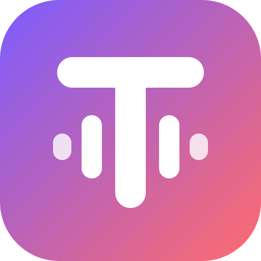

<p align="center"></p>

<h1 align="center">Timbre for Mac</h1>

<p align="center"><b>Your voice. Nobody else's.</b></p>

<p align="center">
  <a href="https://github.com/Timbre-ai/download/releases/latest/download/Timbre-arm64.dmg"><b>Download for Mac</b></a>
  ·
  <a href="https://github.com/Timbre-ai/download/releases">All releases</a>
</p>

Timbre clones your voice on your own Mac, reads your scripts in it, and signs
every clip you export. Your voice sample never leaves your machine, and anyone
can check whether a clip really came from you.

## Install

1. Download **Timbre-arm64.dmg** from the
   [latest release](https://github.com/Timbre-ai/download/releases/latest).
2. Open it and drag **Timbre** into **Applications**.
3. The app isn't notarized yet, so macOS blocks the first launch. Right-click
   Timbre in Applications, choose **Open**, then **Open** again. You only do
   this once.
4. On first launch Timbre downloads the voice model once (about 3.7 GB). After
   that it runs offline.

Requirements: a Mac with Apple Silicon (M1 or newer), macOS 13 or later, and
about 6 GB of free disk space.

Check a download against its checksum:

```bash
shasum -a 256 -c Timbre-arm64.dmg.sha256
```

## What's in the app

- **The studio.** Record a 30-second sample opened by a spoken consent line,
  write scripts, retake sentences, and export clips.
- **The voice engine.** It runs on your Mac inside a macOS sandbox that blocks
  its network. Nothing is uploaded.
- **Signed exports.** Every clip is labelled AI-generated, watermarked, signed
  with Ed25519 and written to an append-only clip log.
- **Your space.** Keep projects on this Mac, or sign in to share an end-to-end
  encrypted space with the people you invite.

When you close the window, Timbre keeps running in the menu bar so teammates'
requests for your shared voice still go through.

## Honest limits

- Apple Silicon only for now, and not yet notarized.
- WAV export only. Lossy formats would drop the signed record.
- The watermark survives gain and light noise, not cropping, resampling or
  re-encoding. The signature is the real proof.

## Use it responsibly

Only clone your own voice. Every cloned voice needs your spoken consent line.
Don't present an export as a live recording, and don't use Timbre to
impersonate, deceive, harass or defraud anyone.

---

This repository only hosts releases. Report problems in
[Issues](https://github.com/Timbre-ai/download/issues).
